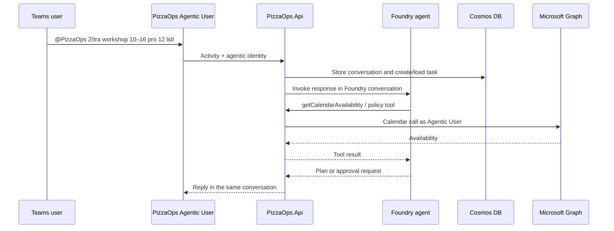

# PizzaOps reference architecture

PizzaOps is an autonomous Microsoft 365 teammate for workshop planning. The
Microsoft Foundry **Prompt Agent** is the only reasoning runtime. The custom C#
service is deliberately narrow: it bridges an Agentic User to Teams, exposes
calendar/state tools, delivers Graph notifications to an event queue, and sends
proactive Teams messages.

## Architecture

```mermaid
flowchart LR
    User[Teams user] -->|@PizzaOps activity| Bridge[PizzaOps.Api
Teams SDK + Agentic User]
    Bridge -->|Agent Responses + conversation| Foundry[Foundry Prompt Agent
Microsoft Copilot harness]
    Foundry -->|OpenAPI tool calls| API[PizzaOps tool endpoints]
    API --> State[(Cosmos DB
tasks + events)]
    API --> Graph[Microsoft Graph calendar]
    API -->|schedule exact due time| Bus[Service Bus
scheduled wakeup queue]
    Graph -->|change notification| Webhook[Graph notification endpoint]
    Webhook --> Bus
    Bus -->|event-driven scale| Worker[Wakeup worker]
    Worker -->|resume original conversation| Foundry
    Worker -->|proactive send| Bridge
    Bridge -->|send with stored conversation| User
    Foundry --> Trace[Foundry tracing]
    API --> Insights[Application Insights]
    Worker --> Insights
    Bridge --> Insights
    Admin[Agent 365 registry and governance] -. registry sync .-> Foundry
```

## Component mapping

| Component | Service | Responsibility | Managed or custom |
|---|---|---|---|
| Agent runtime | Microsoft Foundry Prompt Agent | Instructions, reasoning, tool orchestration, conversation | Managed |
| Agent harness | `microsoft_copilot_preview` | Managed Copilot agent loop | Managed preview |
| Skills | Foundry Skills | Planning, calendar, continuation, approval procedures | Managed, source in repository |
| Tool surface | Inline OpenAPI tool | State, policy, calendar, wakeups, notifications | Custom C# API, Foundry-managed invocation |
| Teams endpoint | Microsoft Teams SDK 2.2.1 | Receive activities under an Entra agent identity blueprint | Custom integration bridge |
| Agentic User | Agent identity blueprint + activated factory | AI teammate identity and Teams presence | Tenant-managed configuration |
| Calendar | Microsoft Graph | Availability and event changes as the Agentic User | Managed API |
| Durable state | Azure Cosmos DB for NoSQL | Tasks, approvals, triggers, idempotency and conversation references | Managed |
| Wakeups | Azure Service Bus scheduled messages | Exact, at-least-once event delivery without agent polling | Managed |
| Execution | Azure Container Apps | Public Teams/Graph/tool endpoints and queue-driven worker | Custom app on managed compute |
| Observability | Foundry tracing, Application Insights, Log Analytics | Agent/tool/queue/Teams correlation and failures | Managed |

## Why a custom Teams bridge is required

Foundry can directly publish an agent to Microsoft 365 and Teams. That route
creates the Activity Protocol and bot registration, but a Prompt Agent does not
become an Agent 365 autopilot or receive an Entra agent user. Current public
documentation also does not expose a managed Foundry API for capturing Teams
conversation references or sending proactive messages.

PizzaOps therefore uses the documented agent-factory pattern:

1. An Entra agent identity blueprint authenticates the C# Teams SDK endpoint.
2. An administrator activates an Agentic User from the factory.
3. The bridge receives every Teams activity for that AI teammate.
4. The bridge stores the conversation and Agentic User identity, then invokes
   the Foundry agent.
5. The worker later rehydrates the same identity and conversation to send a
   proactive message.

This does **not** turn the bridge into a second agent loop. It does not choose
tools, reason about pizza planning, or own the conversation policy. It only
performs channel/identity/I/O operations that the managed Foundry channel route
does not currently provide.

## Tool protocol choice

PizzaOps exposes the custom capability as a Foundry OpenAPI tool with managed
identity rather than a custom MCP server. The current operations are ordinary
request/response calls with typed JSON, OpenAPI is directly supported by the
managed harness, and the managed-identity auth path works for a Teams-published
agent without delegated user-token passthrough. This avoids an unnecessary MCP
gateway while preserving the same Skill/Tool/Policy separation.

If later tools need multi-operation discovery or a third-party MCP protocol,
`PizzaOps.Api` can be wrapped with a remote MCP endpoint. The API's domain
services and server-side policy do not need to change; the Foundry tool binding
would move from `openapi` to `mcp` with a project connection and explicit
`allowed_tools`.

## Interactive request flow



## Autonomous continuation

The agent never remains resident and does not poll:

1. The agent writes the incomplete task snapshot and calls `scheduleWakeup`.
2. PizzaOps.Api creates the idempotency event and enqueues a Service Bus
   scheduled message for the exact due time.
3. The Container App can scale to zero when there is no HTTP or queue work.
4. Service Bus scales a worker replica when the message becomes visible.
5. The worker claims the stored event with optimistic concurrency, invokes the
   Foundry conversation, and processes the agent's tool decisions.
6. The bridge uses the saved conversation ID, service URL, and Agentic User
   identity to send the proactive Teams message.

Graph calendar subscriptions follow the same queue boundary. The public Graph
webhook validates the subscription token and `clientState`, records the source
event, and enqueues a change wakeup. Graph subscriptions do not call a Foundry
routine directly because Routines currently has no Graph/calendar trigger.

## Durable model and concurrency

The Cosmos `tasks` container uses `/tenantId` as its partition key. Each task
contains:

- `id`, tenant, owner, status, version, and ETag;
- workshop and lunch timestamps plus IANA/Windows time-zone value;
- headcount and pizza-planning assumptions;
- approval IDs and canonical request hashes;
- meeting event associations;
- Foundry conversation ID;
- Teams conversation ID, service URL, and serialized Agentic User identity;
- scheduled wakeup and notification IDs.

The separate `events` container also partitions by `/tenantId`. Its item IDs
are derived from idempotency keys so duplicate Graph, Service Bus, Teams, or
human approval callbacks become no-ops. A task update supplies its version and
uses the Cosmos ETag; a stale update returns `412` rather than overwriting work.

Service Bus delivery is at least once. Logical exactly-once behavior comes from
the event ledger and conditional task updates, not from assuming the transport
cannot redeliver.

## Policy boundary

Business safety is implemented in code and not delegated to prompt wording.

| Class | Examples | Enforcement |
|---|---|---|
| Autonomous | Calendar reads, free/busy, plan calculation, task updates, notification creation, exact wakeup | Policy service returns `autonomous` and audits the call |
| Approval required | Material event create/update, attendees changed, externally visible commitment | Requires an unexpired approval bound to the canonical input |
| Denied | Payment, checkout, card data, credentials, financial transaction | API returns a denied decision; no downstream adapter is exposed |

Each policy decision records the task, operation, canonical input hash, decision,
actor identity, and correlation ID.

## Observability

All service logs use `traceId`, `taskId`, `eventId`, `foundryConversationId`, and
`teamsConversationId`. Foundry tracing covers model and tool spans. Application
Insights covers:

- Teams inbound and proactive send success/failure;
- Graph requests, change notifications, and subscription lifecycle;
- policy decisions and approval state;
- Service Bus delivery, duplicate suppression, latency, and dead letters;
- task state/version conflicts;
- Foundry invocation latency and response failures.

Conversation and activity payloads are not logged by default. Logging structured
identifiers is preferred so M365 and pizza-planning content can be redacted or
excluded by tenant policy.

## Extending PizzaOps

### Add a Skill

1. Create a directory in `foundry-skills/` with `SKILL.md`.
2. Publish it with `azd ai skill create/update`.
3. Pin the returned immutable version under `skills` in
   `foundry/pizzaops/azure.yaml`.
4. Redeploy only the declarative agent version. No C# agent-loop code changes.

### Add a Tool

1. Add the operation to a typed interface and adapter in `PizzaOps.Api`.
2. Enforce autonomous/approval/denied policy server-side.
3. Add the operation to generated OpenAPI and tests.
4. Add the matching inline OpenAPI operation in the Foundry definition.
5. Redeploy the API and create a new immutable agent version.

Future room booking, catering, restaurant, travel, customer visit, and workshop
skills can follow the same Skill/Tool/Policy pattern.
