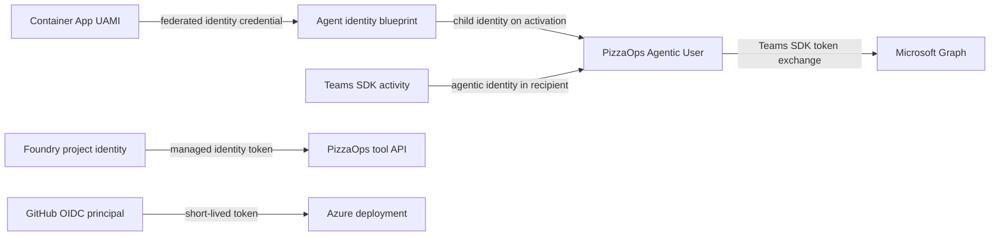

# PizzaOps identities and least privilege

PizzaOps uses more than one Entra identity because the Foundry Prompt Agent and
the Agentic User have different platform responsibilities.

| Identity | Where it exists | Responsibility | Minimum access |
|---|---|---|---|
| Foundry project identity | Foundry project | Invoke the custom OpenAPI tool and access the model through Foundry RBAC | Foundry User at project scope; tool-call app role to PizzaOps.Api |
| Container App UAMI | Azure resource group | Workload credential, Cosmos, Service Bus, ACR, and federated assertion for the blueprint | Data-plane-only roles on exact resources |
| Agent identity blueprint | Entra tenant | Reusable Teams/Agent 365 factory registration | Only declared Graph scopes and application roles required by the Agentic User |
| PizzaOps Agentic User child identity | Entra/Microsoft 365 tenant | Message in Teams and access its own/authorized calendar context | Calendar scopes approved by tenant; mailbox scope restricted with policy |
| GitHub workload identity | Entra app/service principal | Deploy infrastructure and publish agent/image from approved environment | Deployment-scoped Contributor plus image/project roles |

## Credential flow

No client secret is required for the deployed Teams bridge. For local
development, use a short-lived tenant-approved developer credential and never
commit it.

## Calendar permissions

Use only the minimum Graph calendar permissions needed by the tenant's
production scenario. Prefer operations against the PizzaOps Agentic User's own
calendar. If the scenario requires another mailbox, the tenant must explicitly
approve and constrain that access with supported Microsoft 365 application
access policy; the bridge does not bypass it.

An interactive Work IQ connection is not used for unattended Teams continuation.
Work IQ currently requires delegated identity, while a Teams-published Foundry
agent uses project identity.

## Tool authorization

The Foundry project managed identity obtains a token for
`PIZZAOPS_API_AUDIENCE`. The C# API validates:

1. issuer/tenant;
2. audience;
3. token signature;
4. allowed Foundry project client/application identity or app role;
5. task tenant binding and operation policy.

The task ID is not an authorization grant. It can only select a task after the
caller passes tool authentication and tenant checks.

## Teams proactive identity

The service stores the Agentic User identity and conversation reference only
from an authenticated inbound Teams activity. It serializes the identity so a
later Service Bus continuation can acquire a token and call Teams as the same
PizzaOps teammate. It does not persist the access token.

## Governance

Registering the Foundry agent sends registry and activity data to Agent 365 only
after the tenant has the required license, Frontier/preview enablement where
applicable, and an administrator accepts the terms. Foundry and Agent 365 have
different data-residency models; review the data flows before tenant
publication.
