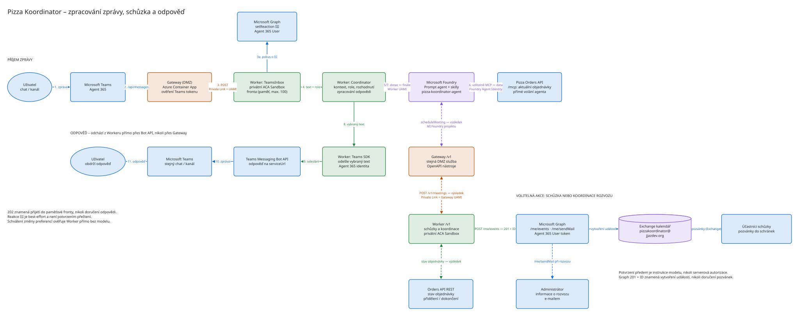

# Pizza Koordinator: nasazeni a provoz

Tento dokument popisuje aktualni nasazeni a opakovatelny postup. Jeho prikazy
spoustejte z korene repozitare. Referencni `mvp-pizzaops` zustava samostatny;
jeho nasazovaci konfigurace take pouziva anonymizovane identifikatory.

## Aktualni prostredi

Nasledujici hodnoty jsou snimek stavu overeneho 27. 11. 2026 po 20:31 CET;
revize, image a ID Workeru se pri dalsim nasazeni mohou zmenit.
ID tenanta, subscription a konkretnich objektu jsou anonymizovana; pred spustenim
prikladu s `<...>` dosadte hodnoty sveho prostredi.

| Nastaveni | Hodnota |
|---|---|
| Tenant | `<AZURE_TENANT_ID>` |
| Subscription | `<AZURE_SUBSCRIPTION_ID>` |
| Resource group / region | `rg-jjazure-ai-pizza-apps` / Sweden Central |
| Container Apps environment | `cae-pizza-22df` |
| Container Registry | `crpizza22dfk5ihazv` |
| Orders API | `https://pizza-orders.proudflower-ac7d0444.swedencentral.azurecontainerapps.io` |
| Orders API revision | `pizza-orders--0000007`, image digest `sha256:f4b62849b6879a24d8994112504403528590edae4c14e06dd0d326a5d72ec13e` |
| Foundry projekt | `ai-pizza-22df-k5ihazv` / `pizza-ordering-agent` |
| Gateway (DMZ, verejny ingress) | `ca-pizzakoordinator--0000008`, UAMI `id-pizzakoordinator-gateway`, image digest `sha256:3aa30717289b13f55d7f492e77d0de0e3892fedc13ad5acae3eb3ac4d72b292e` |
| Worker (ACA Sandbox, aktivni) | `<WORKER_SANDBOX_ID>`, label `app=pizzakoordinator-worker`, image digest `sha256:e040d761ac07df11443ca1d90e67cf9e8bdfa3e1f15d083553aa14e441c23a46` |
| SandboxGroup / identita | `sbg-pizzakoordinator` / existujici UAMI `id-pizzakoordinator` |
| Privatni Express environment | `cae-pizzakoordinator-sandbox`, public network access `Disabled` |
| Private Endpoint | `pe-sbg-pizzakoordinator` v `vnet-pizza-22df/snet-private-endpoints` |
| Private DNS | `privatelink.swedencentral.azurecontainerapps.io`, link do existujici VNet |
| Log Analytics | `workspace-rgjjazureaipizzaappsC0Lb` (vytvoril ACA pri zalozeni Express environmentu) |

Pouzite hodnoty instance, overene v Azure, Microsoft Graph, katalogu Microsoft 365
a v importovanem ZIPu:

| Objekt | ID / hodnota |
|---|---|
| Agent 365 blueprint app ID | `<BLUEPRINT_APP_ID>` |
| Blueprint service principal ID | `<BLUEPRINT_SERVICE_PRINCIPAL_ID>` |
| Teams manifest ID / verze | `<TEAMS_MANIFEST_ID>` / `1.0.0` |
| Agentic User template ID v manifestu | `pizza-koordinator-agentic-user-template` |
| Importovana sablona v katalogu | `<AGENT_TEMPLATE_ID>` |
| Agent Identity ID | `<AGENT_IDENTITY_ID>` |
| Agent User ID / UPN | `<AGENT_USER_ID>` / `pizzakoordinator@jjazdev.org` |
| Sponsor | `jjadmin@jjazdev.org` (`<SPONSOR_OBJECT_ID>`) |
| Worker UAMI `id-pizzakoordinator` client ID / principal ID | `<WORKER_CLIENT_ID>` / `<WORKER_PRINCIPAL_ID>` |
| Foundry agent | `pizza-koordinator-agent`, aktivni verze `6`, model `gpt-5-mini` |
| Foundry skills | `courier-preferences`, `delivery-coordination`, `preference-change-approval`, vsechny verze `2` |

Sablona a instance jsou navazane na stejny blueprint. Worker pouziva blueprint
jako `AzureAd__ClientId` s credentials; federovany credential
`pizzakoordinator-container-app` pouziva principal ID Worker UAMI jako `subject`.
Gateway pouziva stejny `AzureAd__ClientId` jen k overeni prichozich Teams tokenu,
bez credentials, a s nastavenymi credentials odmitne start.

Po poslednim nasazeni 27. 11. bezi revize `ca-pizzakoordinator--0000008` se 100 %
provozu a jeden Worker Sandbox je `Running`. Predchozi dva Sandboxy jsou `Stopped`,
nikoli smazane. Pri vymene se neprenesla pametova prirazeni,
preference ani vazba chatu; kanal se musi znovu navazat a existujici nova objednavka
muze byt oznamena znovu. `Verify-Deployment.ps1` prosel kontrolou Private Link,
hranice identit, RBAC, aktivni operace `scheduleMeeting` a dokonceneho read-only
OpenAPI volani `listDeliveries`. Pocet sledovanych objednavek z tohoto testu neni
poctem novych objednavek. Stary workspace `log-pizza-22df` zustal nedotcen; ACA vytvoril samostatny
`workspace-rgjjazureaipizzaappsC0Lb` pro nove Express environment. Skript sam
neoveruje doruceni Teams zprav, reakci ani udalosti kalendare.

27. 11. 2026 byl opraven chybejici delegovany grant `AgentData.ReadWrite` pro Messaging
Bot API na blueprintu. Zprava z Teams pred opravou dorazila do Workeru, ale odeslani
odpovedi selhalo s `AADSTS65001`. Po obnoveni grantu byla overena dedicnost i ziskani
tokenu a agent v Teams odpovedel na testovaci dotaz „Ahoj, co umis?“. Pricinou mizeni
grantu bylo `az ad app permission admin-consent`: prepise granty podle
`requiredResourceAccess`, kde Messaging Bot API neni. Registracni skript ho proto
nevola a potrebne scopy doplnuje primo do `oauth2PermissionGrants`.
`Verify-Deployment.ps1` kontroluje messaging grant i konfiguraci jeho dedeni;
tato kontrola nenahrazuje test doruceni zpravy. Export stdout/stderr Workeru
do Log Analytics neni nakonfigurovan; logging Sandboxu se nastavuje zvlast.

Worker prednostne vybira posledni textovou zpravu asistenta a instrukce agenta
vyzaduji odpoved v 1–2 kratkych vetach. Pokud posledni textovou zpravu nenajde,
pouzije `GetOutputText()`, ktery muze obsahovat i dalsi text. U neprazdne prijate
zpravy se dostupnou identitou a cestou ke zprave Worker zkusi pridat reakci 👀
pres Graph `setReaction`. Jde o reakci, nikoli Teams potvrzeni precteni; selhani
reakce se zaloguje a zpracovani odpovedi pokracuje. Odpoved „Ahoj, co umis?“
byla v Teams overena pred poslednim nasazenim. Pred vymenou Workeru pro kalendar
byla v Teams 27. 11. overena strucna odpoved „Mame 1 novou objednavku.“ i reakce 👀.

`aca sandbox apply` nepodporuje `-o none`, skript pouziva `-o json`.

Instance ma licence `AGENT_365`, `Microsoft_365_Copilot`,
`Microsoft_365_E5_(no_Teams)`, `Microsoft_Teams_Enterprise_New` a `FLOW_FREE`;
`usageLocation=CZ`. Skript nastavuje sponsora, ne managera.

### Schuzky v kalendari agenta

Pri diagnostice 27. 11. 2026 agent v Teams chybne potvrdil pozvanku „Pizza“
na 1. 12. v 08:00, prestoze tehdy nasazena verze 4 nemela nastroj pro samostatne
schuzky. Worker v dobe pozadavku nevolal Graph `/me/events`. Read-only kontrola
z Worker Sandboxu ziskala token s `oid` Agent User a `appid` Agent 365 Identity;
Graph `/me/calendarView` vratil 200 a v pozadovanem terminu nenasel udalost
„Pizza“. Samotny token neprokazuje doruceni pozvanky.

Nasazena verze 6 poskytuje `scheduleMeeting` pres existujici OpenAPI connection,
Gateway a Worker. Worker vytvari udalost s ucastniky pres Graph `POST /me/events`
tokenem Agent 365 User, nikoli uctem tazajiciho se ani Foundry Agent Identity.
Instrukce zadavaji vyzadovat predem potvrzeni uzivatele; nejde o samostatnou
serverovou autorizaci potvrzeni. Odeslani se nesmi tvrdit bez odpovedi Graph
`201 Created` a ID udalosti; prijeti pozadavku nepotvrzuje doruceni do schranky.
Pri nejasnem vysledku je nutne pred opakovanim zkontrolovat kalendar. Stabilni
`transactionId` omezuje duplicity pri stejnem opakovanem pozadavku, ale neni
zarukou proti vsem duplicitam. Neexistujici a nejednoznacny mistni cas pri
prechodu na letni/zimni cas vyzaduje upresneni ci explicitni offset.

Po jednorazovem potvrzeni byla v kalendari `pizzakoordinator@jjazdev.org` nalezena
jedna nezrusena udalost „Pizza“ na 1. 12. 2026 08:00–08:30 CET se dvema ucastniky.
V odeslane poste agenta byla ve
stejnem case nalezena jedna zprava „Pizza“ pro oba ucastniky. Agent v Teams
potvrdil vytvoreni schuzky a uzivatel nasledne potvrdil doruceni obema
prijemcum. Samotne vytvoreni udalosti ani zaznam v odeslane poste doruceni
nedokladaji. Pozvanku bez predchozi kontroly kalendare znovu nevytvarejte.

Pokud se pozvanka k rozvozu vytvori, ale e-mail adminovi selze, Worker jiz
prirazeni neuvolni a pri stejnem opakovani nevytvori dalsi pozvanku. Stav je
vsak stale pouze v pameti, a po restartu je nutne overit existujici udalosti.

#### Provedene nasazeni opravy

1. V existujicim ACR byl sestaven Worker image `pizzakoordinator-worker:calendar-007e22a36000`
   s digestem uvedenym vyse. `Deploy-WorkerSandbox.ps1 -ReplaceWorker` zastavil
   predchozi Worker a spustil novy; predchozi Sandbox zustal zachovan pro obnovu.
2. Gateway byla aktualizovana na URL noveho Workeru. Foundry agent byl aktualizovan
   skriptem `Deploy-FoundryAgent.ps1` s existujicimi connections a defaultnimi verzemi
   skillu. Chybne OpenAPI ve verzi 5 bylo opraveno a aktivni verze je 6.
3. `Verify-Deployment.ps1` overil dostupnost a autentizaci Gateway a Workeru,
   aktivni operaci `scheduleMeeting` i skutecne dokoncene read-only OpenAPI volani.
   Samostatny test schuzky a doruceni je popsany vyse.

Tento cilovy update nemenil Orders API, topologii prostredi ani granty; aktualizoval
vsak URL Workeru v Gateway. Pro nove nasazeni je nutne znovu posoudit dopady
a pripadne schvalit vymenu Workeru; zbytecne
opakovana vymena maze jeho pametovy stav. Plny `Deploy-ExistingEnvironment.ps1`
navic aktualizuje i Orders API. Pri minulem nasazeni Foundry byla pouzita ochrana,
ktera zabranila vytvareni novych connections a skillu; samotny
`Deploy-FoundryAgent.ps1` je pri neuspesnem `show` muze vytvorit.

### Identity a opravneni

| Volajici | Pouziti |
|---|---|
| Gateway UAMI | Pristup k ACR a app role `PizzaKoordinator.Tool`; tokenem se autentizuje k Workeru pres Private Link. Gateway nema Worker UAMI ani credentials blueprintu. |
| Worker UAMI | Pristup k ACR a role `Foundry User`; federovany credential umoznuje jednat pres Agent 365 blueprint. |
| Agent 365 Identity / User | Delegovane volani Graph a odesilani Teams odpovedi pres Messaging Bot API. |
| Foundry Agent Identity | Connection `pizzakoordinator-orders-mcp` typu `RemoteTool` s `AgenticIdentityToken` vola primo Orders MCP `/mcp`; Orders API kontroluje tenant, audience a povolene client ID agenta. Jde o jinou identitu nez Agent 365 Identity. |
| Managed identity Foundry projektu | OpenAPI connection `pizzakoordinator-openapi` s `ProjectManagedIdentity` vola Gateway `/v1`; Gateway overuje tenant a client ID projektu. |

Registracni skript zajistuje pro blueprint tenantovy souhlas `AllPrincipals`
s temito delegovanymi scopy a zachovava i pripadne dalsi existujici scopy:

| Prostredek | Scopy zajistovane skriptem |
|---|---|
| Messaging Bot API | `AgentData.ReadWrite` |
| Microsoft Graph | `Calendars.ReadWrite`, `Mail.Send`, `Chat.ReadWrite`, `ChatMessage.Send`, `ChannelMessage.Send` |
| Agent 365 Tools | `McpServersMetadata.Read.All` |
| Power Platform API | `Connectivity.Connections.Read` |

Pri kontrole 27. 11. obsahoval stavajici Graph grant navic `Mail.ReadWrite`,
`User.Read.All`, `Sites.Read.All`, `Files.ReadWrite.All` a `ChannelMessage.Read.All`.
Nejde o seznam minimalnich prav pro tento tok; pred pripadnym odebranim je nutne
posoudit ostatni pouziti a ziskat souhlas spravce. Tento dokument prava nemeni.

## Komponentove schema: zprava, schuzka a odpoved

[](komponentove-schema.svg)

Alternativni textova verze:

```mermaid
flowchart LR
    U["Uzivatel<br/>chat nebo kanal"] -->|"1. zprava"| T["Microsoft Teams<br/>Agent 365"]
    T -->|"2. /api/messages"| G["Gateway - DMZ<br/>overi Teams token"]
    G -->|"3. Private Link + UAMI<br/>POST /internal/teams/activities"| I["Worker - TeamsInbox<br/>pametova fronta"]
    I -.->|"3a. pokus o reakci"| GR["Microsoft Graph<br/>setReaction 👀"]
    I -->|"4. text a role"| C["Worker - Coordinator"]
    C <-->|"5 / 7. dotaz a odpoved<br/>Worker UAMI"| F["Foundry Prompt agent<br/>instrukce a skilly"]
    F <-->|"6. volitelne MCP<br/>Foundry Agent Identity"| O["Orders API /mcp<br/>cteni objednavek"]
    C -->|"8. vybrany text"| S["Worker - Teams SDK"]
    S -->|"9. Agent 365 identita<br/>serviceUrl"| B["Messaging Bot API"]
    B --> T2["Teams<br/>stejny chat nebo kanal"]
    T2 --> U2["Uzivatel<br/>obdrzi odpoved"]
    F <-->|"6a. scheduleMeeting / OpenAPI<br/>managed identity projektu"| G2["Gateway /v1<br/>stejna DMZ sluzba"]
    G2 <-->|"Private Link + Gateway UAMI"| W["Worker /v1<br/>schuzky a koordinacni operace"]
    W <-->|"stav objednavek"| OR["Orders API REST"]
    W <-->|"POST /me/events; 201 + ID<br/>Agent 365 User token"| GE["Microsoft Graph<br/>kalendar"]
    GE -->|"vytvoreni udalosti"| CAL["Exchange kalendar<br/>PizzaKoordinator"]
    CAL -->|"pozvanky"| P["Ucastnici<br/>jejich schranky"]
```



Gateway odpovi na predani `202` uz po vlozeni do fronty; to neni potvrzeni
zpracovani ani doruceni odpovedi. Pri plne fronte Worker vraci `503`. Reakce
je pouze pokus; pri chybejicich udajich o zprave se neposila. Schvaleni nebo
zamitnuti preference zpracovava Worker po kontrole admina primo, bez modelu.
Po potvrzeni schuzky se vysledek Graph vraci pres Worker a Gateway do Foundry;
odpoved i reakce odchazeji z Workeru primo, nikoli zpet pres Gateway.

## Nasazeni do existujiciho prostredi

Predpoklady: PowerShell 7.3+, Azure CLI s aktualnim preview rozsirenim `containerapp`
(podpora `--environment-mode Express`), ACA CLI `aca` alespon `1.0.0-preview.5`,
`azd` s rozsirenim `ai`, `a365`, .NET 10,
Python s Pillow pro ikony Teams balicku a PowerShell modul
`Microsoft.Graph.Authentication`. Prihlaseni a pozadovane opravneni musi platit
pro spravny tenant. Skripty loguji do ignorovane slozky `.local`.

CLI `aca` je samostatny nastroj, ne prikaz `az containerapp`; instalace je popsana
v [oficialnim navodu](https://sandboxes.azure.com/docs/sandboxes/quickstart/setup-cli).
Skripty neinstaluji ani neaktualizuji nastroje a chybejici podporu ohlasi pred nasazenim.
Na Windows byla overena verze `aca 1.0.0-preview.5`; Sweden Central je v seznamu
podporovanych Sandbox regionu. Pokud Azure CLI pri nacitani globalnich extension hlasi
`Access is denied`, pouzijte izolovanou slozku v ignorovanem `.local` a v teto PowerShell
session ponechte nastavene `AZURE_EXTENSION_DIR` i pri spousteni orchestratoru:

```powershell
$env:AZURE_EXTENSION_DIR = Join-Path (Get-Location) 'pizza-koordinator\.local\azure-cli-extensions'
az extension add --name containerapp --allow-preview true
```

Tento postup nemeni globalni Azure CLI extensions. V overovacim prostredi byla globalni
extension slozka necitelna kvuli `arcappliance-1.4.1.dist-info`; izolovana extension `1.3.0b6`
poskytla pozadovany prepinac `--environment-mode Express`.
Spravce potrebuje prava na infrastrukturu, prirazeni identit a roli
`Container Apps SandboxGroup Data Owner` na skupine. Pri zalozeni skupiny se ji ACA CLI
pokusi priradit prihlasenemu spravci. Gateway ani Worker tuto spravni roli nedostavaji.

Spusteni z korene repozitare:

```powershell
$env:AZURE_SUBSCRIPTION_ID = '<overene-subscription-id>'
$env:AZURE_TENANT_ID = '<overene-tenant-id>'
$env:PIZZAKOORDINATOR_TEAMS_APP_ID = '<puvodni-teams-app-id>'
az account set --subscription $env:AZURE_SUBSCRIPTION_ID
.\pizza-koordinator\scripts\Deploy-ExistingEnvironment.ps1
```

Overte, ze vybrana subscription patri uvedenemu tenantovi. Pro existujici
Teams sablonu pouzijte jeji puvodni app ID; nove GUID zvolte pouze pro novou
sablonu. Lze take predat `-SubscriptionId`, `-TenantId` a `-TeamsAppId`
primo. `a365.config.json` nema tenant natvrdo: registracni skript ho predava
CLI explicitne. Vsechna ID v prikladu musi byt platna neprazdna GUID.
Samostatne spoustene nasazovaci a overovaci skripty vyzaduji prislusne
parametry nebo stejne promenne prostredi.

Orchestrator odvozuje client ID z aktivni Foundry Agent Identity v existujicim `azd`
prostredi. `Register-OrdersMcpApi.ps1` idempotentne pripravi samostatnou Entra audience
pro Orders MCP; tato audience se nesdili s verejnym tool API. Orders API nasledne povoli
jen identity konkretniho Foundry agenta a nakonfigurovany tenant.

Orchestrator provede tyto kroky:

1. Vybere nakonfigurovanou subscription a overi Orders API.
   Spusti `Update-OrdersApi.ps1`, ktery sestavi a nasadi novy image `pizza-orders`,
   nastavi MCP tenant, audience a povoleny agent client ID; meni tedy existujici Azure
   prostredek. Read-only MCP endpoint zustane nedostupny, dokud neni konfigurace uplna.
   Anonymni auth probe pouziva platnou JSON-RPC `initialize` zpravu; prazdne `{}` je
   chybny MCP pozadavek a vraci 400, takze neoveruje autentizaci.
2. Spusti `Deploy-PizzaKoordinator.ps1 -PrepareOnly` pro tool API a obe identity
   (Worker: AcrPull + Foundry User; Gateway: AcrPull + app role `PizzaKoordinator.Tool`).
3. Spusti `Register-PizzaKoordinator.ps1`: Agent 365 blueprint, Teams messaging
   endpoint `/api/messages` (Gateway), federaci jen Worker UAMI, consent a potrebne granty.
   ID service principal objektu pro Graph, Messaging Bot API, Agent 365 Tools a Power Platform
   vyhleda podle jejich aplikacnich ID v cilovem tenantovi. Vygeneruje ZIP
   `.local\pizzakoordinator-agent-template-1.0.0.zip` s predanym Teams app ID.
4. Sestavi image `pizzakoordinator-worker` a `pizzakoordinator-gateway` (nebo pouzije
   `-WorkerImage`/`-GatewayImage`). `Deploy-WorkerSandbox.ps1` vytvori samostatny privatni
   Express environment, Private Endpoint a DNS link v existujici VNet; verejne prostredi
   `cae-pizza-22df` nemeni. Teprve potom zalozi SandboxGroup s jednorazovou vazbou na toto
   prostredi, pripoji Worker UAMI a importuje digest image z ACR jako disk image.
   Pred spustenim Workera pozastavi aktivni revizi puvodniho monolitickeho polleru; odmitne
   pokracovat, pokud je aktivni vice revizi nebo uz soucasne bezi Sandbox Worker. Z manifestu
   `.local\worker-sandbox.json` pak spusti jeden Worker s vypnutym auto-suspend i auto-delete
   a deny-by-default egressem. Nasledne nasadi Gateway s URL portu vracenou sluzbou a
   blueprintem bez credentials. Nakonec nasadi Foundry agenta, OpenAPI connection
   na Gateway a agentic-identity MCP connection k Orders pres `Deploy-FoundryAgent.ps1`.
   Skript vytvori jen chybejici skilly; u existujicich pouzije jejich defaultni
   verze a zmeny souboru skillu v repozitari sam nezverejni.
5. Overi nasazeni pres `Verify-Deployment.ps1`; toto overeni vola Foundry agenta
   a muze spotrebovat modelove tokeny.

Konfiguracni label Sandboxu je 63 znaku (prefix SHA-256), protoze delsi label Azure
odmitne. Po `aca sandbox apply` skript vyhleda alokaci podle tohoto labelu misto parsovani
nestabilniho vystupu prikazu; pri nejasnem vysledku ji nikdy slepe nevytvari znovu.

Prechod z jednodilneho bridge: Gateway zachovava nazev `ca-pizzakoordinator`, takze se
messaging endpoint ani URL OpenAPI nastroju nemeni. Stara revize se deaktivuje pred startem
Workera, takze nedochazi k soubehu dvou polleru; nove objednavky behem kratkeho prechodu
zustanou ve stavu `New`. Skript aplikaci prepne na Gateway UAMI (vcetne pristupu do ACR),
nahradi vsechny env promenne (odstrani credentials blueprintu) a odebere z ni Worker UAMI.
Pri chybe Sandbox nasazeni se Worker zastavi pred opetovnou aktivaci stare revize. Pri chybe
prepnuti Gateway nebo nasledneho overeni se nejprve zastavi novy Worker, vrati se Worker UAMI
a jeho ACR pristup a az potom se obnovi puvodni revize. Pokud nelze Worker bezpecne zastavit,
stara revize se neaktivuje, aby se predeslo dvojimu zpracovani objednavek.
Pokud existuje drivejsi `ca-pizzakoordinator-worker` jako Container App, skript skonci:
tento starsi Worker je nutne vyradit samostatne, aby nesledoval objednavky soubezne.
Zadny existujici Worker Container App skript nemaze.

### Soukromy pristup a identita

Port Sandboxu je z pohledu ingress proxy nastaven jako `anonymous`, ale **neni verejny**:
skupina je pred vytvorenim portu navazana na Express environment s vypnutym verejnym
pristupem a schvalenym Private Endpointem. JWT validuje C# Worker (tenant, audience,
`azp` Gateway). Portalove Entra prihlaseni na portu nepouzivame, protoze proxy odstranuje
prihlasovaci token pred predanim aplikaci. Neexistuje fallback na verejny port.

Gateway nema Sandbox Data Owner, pristup k exec API ani identitu Workera. Spravu dela
nasazovaci identita; SandboxGroup obsahuje pouze Worker UAMI. `AZURE_CLIENT_ID` a
`SignedAssertionFromManagedIdentity` zustavaji nastavene na stavajici Worker identitu,
takze federace blueprintu se pri zmene hostingu nemeni.

Vazba SandboxGroup na Express environment je nevratna. Skript odmitne existujici
skupinu navazanou jinam a nikdy ji automaticky nepresouva.

Orchestrator **neimportuje ZIP do Microsoft 365 a nevytvari Agent User**.
Po nasazeni:

1. Spravce importuje ZIP do Microsoft 365 admin centra a overi dostupnou sablonu.
   Pred pokracovanim musi `agentIdentityBlueprintId` v definici sablony odpovidat
   blueprint ID v `a365.generated.config.json` a hodnote `AzureAd__ClientId`
   nasazeneho Workeru i Gateway. Pri neshode instanci nevytvaret.
2. Pro novou instanci nejprve spustit pripravu bez zapisu:

   ```powershell
   .\pizza-koordinator\scripts\Provision-Agent365Instance.ps1 -WhatIf
   ```

   Zkontrolovat tenant, prihlaseny ucet, blueprint, UPN a dostupnost peti SKU.
   Potom spustit skript bez `-WhatIf` a potvrdit operaci. Skript podle vzoru
   `mvp-pizzaops` vytvori Agent Identity a Agent User, nastavi CZ a priradi licence.
   Neprovisionuje samostatne Teams ani mailbox; po vytvoreni overit instanci
   v katalogu a prihlaseni/komunikaci v Teams zvlast.
3. Zkontrolovat v Graphu, ze `agentIdentityBlueprintId` identity odpovida blueprintu
   a `identityParentId` uzivatele odpovida ID identity. V Microsoft 365 admin centru
   otevrit **Agents → Pizza Koordinator → Instances**.

Aktualni instance uz existuje. Opakovane importovani nebo provisioning muze vytvorit
nechtenou instanci; pred jakymkoli opakovanim nejprve zkontrolovat Graph i portal.
Nesmazavat ani neprepisovat `.local\agent365\instance.pizzakoordinator.json` nebo
`a365.generated.config.json`; obsahuji vazbu na existujici objekty a konfiguraci.

## Overeni a udrzba

Overeni Gateway, neautorizovaneho pristupu k tool API a DMZ hranice
(jeden aktivni Sandbox, auto-suspend/delete vypnute, Private Endpoint a DNS link;
Gateway bez credentials blueprintu a bez Worker UAMI; Gateway UAMI ma jen AcrPull):

```powershell
.\pizza-koordinator\scripts\Verify-Deployment.ps1
```

`/health/ready` Gateway musi uspesne zavolat `/v1/deliveries` Workera se svou managed
identity. Overeni tak nespoleha pouze na stav `Running`; overuje i cestu pres Private Link
a aplikacni autentizaci. Skript overi take dedicny Teams messaging grant blueprintu,
aktivniho Foundry agenta a operaci `scheduleMeeting`. Po modelovem smoke testu
samostatne zavola Responses API a zkontroluje dokoncene volani `listDeliveries`
i jeho vysledek podle `call_id` a pole `array_response_data`. Zapisuje nektere
vysledky do `.local` a spotrebovava modelove tokeny; neoveruje vsechny Graph scopy,
reakci 👀 ani doruceni odpovedi v Teams nebo pozvanky. Lokalni testy (bez Azure):

```powershell
dotnet test .\pizza-koordinator\PizzaKoordinator.slnx
.\pizza-koordinator\tests\Test-WorkerSandbox.ps1
.\pizza-koordinator\tests\Agent365Grants.Tests.ps1
.\pizza-koordinator\tests\FoundryToolVerification.Tests.ps1
```

### Diagnostika Teams

Gateway log ukaze prijem a predani aktivity, nikoli vysledek zpracovani ve Workeru:

```powershell
$subscriptionId = az account show --query id -o tsv
az containerapp logs show -g rg-jjazure-ai-pizza-apps -n ca-pizzakoordinator --tail 100 --format text
aca sandbox list --subscription $subscriptionId `
    --resource-group rg-jjazure-ai-pizza-apps --region swedencentral `
    --group sbg-pizzakoordinator -l app=pizzakoordinator-worker -o json
```

Pro aktualni `Running` Sandbox lze zkontrolovat rozhodnuti egress policy:

```powershell
$subscriptionId = az account show --query id -o tsv
aca sandbox egress decisions --subscription $subscriptionId `
    --resource-group rg-jjazure-ai-pizza-apps --region swedencentral `
    --group sbg-pizzakoordinator --id '<aktualni-ID-Workeru>' -o json
```

Povoleny egress nedokazuje uspesny HTTP pozadavek ani doruceni. Worker nema
nakonfigurovany export aplikacnich logu; chybne reakce nebo zpracovani proto
nemusi byt v Log Analytics viditelne. U kanalu navic reakce vyzaduje udaje
`channelData.team.aadGroupId`, `channelData.channel.id` a ID zpravy; pokud
chybi, Worker se o ni nepokusi. Logy mohou obsahovat identifikatory konverzaci
a dalsi citliva data.

`Update-BridgeImage.ps1` meni pouze image Gateway a vyzaduje digest ze stejneho ACR
repository. Sandbox Worker se pres `az containerapp update` neaktualizuje:

```powershell
.\pizza-koordinator\scripts\Update-BridgeImage.ps1 `
    -Image 'crpizza22dfk5ihazv.azurecr.io/pizzakoordinator-gateway@sha256:<digest>' -WhatIf
```

Po kontrole opakovat bez `-WhatIf` a potvrdit. Neprovadet soubezne s aktualizaci
konfigurace aplikaci.

Novy Worker image nebo konfiguraci nasadte pres `Deploy-PizzaKoordinator.ps1`:

```powershell
.\pizza-koordinator\scripts\Deploy-PizzaKoordinator.ps1 `
    -OrdersApiUrl 'https://pizza-orders.proudflower-ac7d0444.swedencentral.azurecontainerapps.io' `
    -BlueprintId '<BLUEPRINT_APP_ID>' `
    -WorkerImage 'crpizza22dfk5ihazv.azurecr.io/pizzakoordinator-worker@sha256:<digest>' `
    -GatewayImage 'crpizza22dfk5ihazv.azurecr.io/pizzakoordinator-gateway@sha256:<digest>' `
    -ReplaceWorker
```

Bez `-ReplaceWorker` se odlisna konfigurace odmitne. Shodny manifest znovu pouzije
existujici Sandbox. Pri vymene se stary Worker zastavi pred aktivaci noveho, ale
nesmaze; jeho Memory snapshot zustava pro rucni obnovu. Novy Worker ma prazdny stav,
takze je nutne znovu navazat Teams kanal. Nasazeni nikdy nespoustejte soubezne.
Orchestrator `Deploy-ExistingEnvironment.ps1` prepinac `-ReplaceWorker` take prijima.
Pri zmenenem Worker image nebo konfiguraci pouzijte pro schvalenou vymenu
`.\pizza-koordinator\scripts\Deploy-ExistingEnvironment.ps1 -ReplaceWorker`;
bez tohoto prepinace se odlisny bezici Worker nenahradi.

Po prerusenem nebo nejasnem vytvoreni nepoustejte slepe dalsi vytvoreni: nejdrive
prohlednete SandboxGroup podle labelu `app` a `configuration` z ulozeneho manifestu.
Skript nezkousi vytvoreni automaticky opakovat a pri duplicitach skonci. Zastavene
Sandboxy a nepouzite disk images odstranuje spravce az po rozhodnuti o obnove.

## Chovani a provozni omezeni

- Orders API se dotazuje kazdych 30 sekund. Kuryrum se po 3 minutach bez reakce
  posle urgence; nejvyse pet urgenci.
- Stav koordinace je v pameti Workeru a bezi prave jeden aktivni Sandbox (Gateway
  je bezstavova, 1–3 repliky). Po restartu nebo vymene Workeru je potreba znovu navazat kanal
  zpravou `@Pizza Koordinator ahoj`. Pred navazanim kanalu se muze jako docasny
  cil oznameni pouzit prvni osobni chat; skutecny kanal ho pozdeji nahradi.
- Prijate zpravy jsou pouze v pametove fronte o kapacite 100. `202` nepotvrzuje
  dokonceni a pri padu se fronta muze ztratit; chyby po jejim odebrani se pouze
  loguji. Worker take sdili jedno Foundry conversation ID pro zpravy a autonomni
  udalosti, nikoli samostatnou historii pro kazdy chat.
- Auto-suspend a auto-delete musi zustat vypnute: odchozi polling objednavek
  neudrzuje Sandbox aktivni a uspany Worker by neposilal urgence. Snapshot nenahrazuje
  databazi ani automaticky restart procesu po padu; sledujte `/health/ready`.
- Novy Express environment, Private Endpoint a stale bezici Sandbox maji vlastni
  provozni naklady. Stavajici VNet, subnet, ACR, Worker UAMI a Foundry se znovu pouzivaji.
- Egress povoluje pouze nakonfigurovane Orders/Foundry hosty, `login.microsoftonline.com`,
  `graph.microsoft.com`, `*.botframework.com` a `smba.trafficmanager.net`. Pred ostrym
  provozem overte skutecne Teams service URL a egress audit; neotvirejte automaticky vsechny hosty.
- Pro spravu preferenci, rezervaci kalendare a dokonceni rozvozu jsou nutne skutecne
  UPN/object ID kuryrskych uctu a overeni prav k jejich Teams a kalendarum.
- Zmena preference se projevi az po schvaleni adminem; schvaleni overuje kod
  podle nakonfigurovaneho Entra object ID ve Workeru.
- `mvp-pizzaops` je samostatny funkcni vzor. Jeho kod ani nasazeni tento postup nemeni.

Podklady: [ACA Sandboxes](https://learn.microsoft.com/azure/container-apps/sandboxes-overview),
[privatni ingress](https://sandboxes.azure.com/docs/sandboxes/private-endpoints),
[managed identity](https://sandboxes.azure.com/docs/sandboxes/identity)
a [zivotni cyklus](https://sandboxes.azure.com/docs/sandboxes/sandbox/lifecycle).
